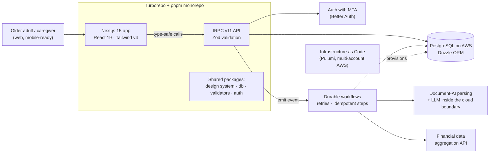

# Confidential Project — HIPAA-Regulated Health & Financial Readiness Platform

**Full-stack product engineering for a U.S. platform that helps older adults and their families get their health, financial, and legal information organized.**

**[Read the full case study online →](https://7pixel-cl.github.io/confidential-platform-showcase/)**

> [!NOTE]
> The client, product name, screens, and source code are under NDA. This page describes **my role and the engineering at a high level only** — no proprietary code, data, designs, or business details are published here. Happy to go deeper in a live conversation, within what the NDA allows.

<!-- case-study:start -->
## At a glance

| | |
| --- | --- |
| **Role** | Full-Stack Developer (remote, U.S. startup) |
| **Timeline** | November 2025 – present |
| **Team** | Founders + a small distributed engineering team |
| **My footprint** | Top contributor to the core monorepo — ~1,100+ of ~2,000 commits |
| **Domain** | Health-tech / fin-tech, HIPAA-regulated, users 60+ and their caregivers |

## The problem (in general terms)

When a health or family emergency happens, the information people need — identity documents, medical history, insurance, trusted contacts, accounts, and legal directives — is usually scattered across drawers, inboxes, and memories. The product guides older adults through short, structured steps to capture that information once, keep it current, and share it safely with the people they trust.

Two constraints shape every engineering decision:

1. **It handles protected health information (PHI).** Security, auditability, and data minimization are requirements, not features.
2. **The primary user is 60+.** Every flow must be calm, legible, forgiving, and accessible — the opposite of a typical "dense dashboard" SaaS.

## What I work on

- **Guided multi-step product flows** — end-to-end features (UI → typed API → database) for the step-by-step journeys at the heart of the product: capture, review, edit, and update, with merge rules so returning users never lose data they already saved.
- **Document AI pipeline** — users upload photos/PDFs of real-world documents (including handwritten ones); a durable background-workflow pipeline parses them with a document-AI provider, maps the output to structured records, and routes low-confidence fields back to the user for confirmation.
- **Durable background workflows** — event-driven jobs with retries, step-level idempotency, and long-running processing, so slow third-party calls never block the UI.
- **Accessible design system** — contributed to the in-house component library built on accessible primitives, documented in Storybook with visual-regression checks in CI.
- **Senior-focused UX quality** — ran heuristic audits (NN/g-style) and persona-driven Playwright end-to-end tests that simulate older users navigating the app, then turned findings into fixes.
- **Financial data features** — flows that connect financial accounts through an aggregation API (sandbox personas for testing) and help users map where their money comes from and goes.

## Architecture (high level)

## Engineering practices on the project

- **Compliance by design:** HIPAA technical safeguards and SOC 2-style controls expressed as infrastructure code; encryption in transit and at rest; least-privilege, multi-account cloud setup; PHI never leaves the approved boundary — including when using LLMs.
- **End-to-end type safety:** one TypeScript model from the database schema (Drizzle) through validators (Zod) and the API (tRPC) to the React UI.
- **Quality gates in CI:** lint, format, typecheck, and unit tests on every PR; Playwright end-to-end suites (auth, navigation, responsive, smoke); Storybook visual-regression checks for the design system.
- **Monorepo at scale:** ~1,800 TypeScript files across apps and shared packages, 130+ database migrations, ~190 test files.
- **AI-assisted delivery, with guardrails:** I use AI coding agents daily, under explicit rules about what code and data they may touch in a regulated codebase.

## What this project demonstrates

- Shipping production features in a **regulated, high-trust domain** without slowing the team down.
- Turning messy real-world inputs (scanned and handwritten documents) into **reliable structured data** with human-in-the-loop review.
- Designing for **accessibility and older users** as a first-class engineering concern, verified with tests — not just good intentions.
- Working **directly with non-technical founders** and a distributed team, from fuzzy feedback ("this feels overwhelming") to concrete, testable changes.

---

**Source availability:** This repository intentionally contains no code. The client's identity and product are confidential.  
**Contact:** [LinkedIn](https://www.linkedin.com/in/marcoalvaradot/) · [Portfolio](https://7pixel.cl) · [GitHub](https://github.com/7pixel-cl)

© 2026 Marco Alvarado. All rights reserved.
