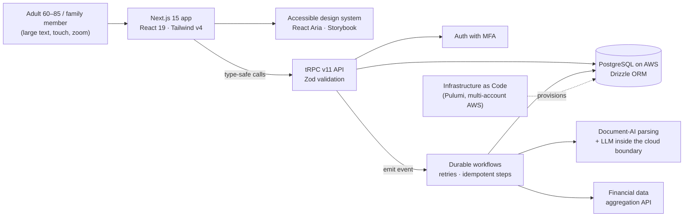

# Built for 60+: A Health & Finance Platform Designed for Older Adults (Confidential Client)

**Full-stack product engineering for a HIPAA-regulated U.S. platform whose users are 60 to 85. Every screen, component, and test is built around how older adults actually see, read, tap, and decide.**

**[Read the full case study online →](https://7pixel-cl.github.io/built-for-60-plus-showcase/)**

> [!NOTE]
> The client, product name, screens, and source code are under NDA. "Built for 60+" is a descriptive name for this showcase, not the product's name. This page covers **my role and the engineering at a high level only**. I'm happy to go deeper in a conversation, within what the NDA allows.

<!-- case-study:start -->
## At a glance

| | |
| --- | --- |
| **Users** | Adults aged 60 to 85, and the family members they trust |
| **Role** | Full-Stack Developer (remote, U.S. startup) |
| **Timeline** | November 2025 to present |
| **Team** | Founders and a small distributed engineering team |
| **Domain** | Health-tech and fin-tech, HIPAA-regulated |
| **My footprint** | Top contributor to the core monorepo: ~1,100 of ~2,000 commits |

## Who it's for

The product helps older adults gather the information their families would need in an emergency: identity documents, medical history, insurance, accounts, legal wishes, and the people they trust. It walks them through short, guided steps to record that information and keep it up to date, then helps them share it safely.

The users are 60 to 85, and that shapes everything. Many read with reading glasses at the largest text size. Some have tremor or arthritis and tap where a button *was* a moment ago. Many are not confident with technology and worry about breaking something.

A typical SaaS interface fails all of them: small grey text, icon-only buttons, layouts that shift, modals, and ten options on one screen. Making the product calm, legible, and forgiving is the core requirement, not a polish pass.

## Designing for older adults

### 1. Hard limits built into the design system
The shared component library enforces minimums for older users:
- **Text:** body text is at least 18px, long-form reading at least 20px, and nothing in the interface is smaller than 16px.
- **Touch:** targets are at least 56px tall, with clear gaps between them.
- **Scaling:** all type is rem-based, so it follows the user's own size settings. Layouts must hold up at **200% zoom on a 320px-wide screen** with no sideways scrolling or clipped controls (WCAG 1.4.10).

Components are built on accessible React Aria primitives and documented in Storybook, so these limits ship by default.

### 2. Color that works for aging eyes
Contrast is measured, not eyeballed. Small text never uses low-contrast accent colors.

Aging eyes struggle to tell apart shades within blue and purple, or within yellow and green. So two states never differ only by hue. Every status also carries a distinct shape and a plain-word label, with a clear gap in lightness.

### 3. Layouts that stay still
Older users aim where a control *was*, so movement causes errors. We designed against that:
- Text-size controls stay in fixed slots as text grows.
- Error messages keep their space reserved, so buttons don't jump.
- Forms show a loading state instead of empty fields until saved answers arrive. Persona testing showed that blank fields invite retyping and duplicated data.
- Animation is limited to functional progress, with no decorative motion.

### 4. One clear next step, in plain words
- One main action per screen.
- Progress shown in words ("Step 3 of 10"), not dots.
- A written scroll cue when something important sits below the fold.
- A Back button that is always present.
- Destructive actions kept away from primary ones.
- Long tasks on full pages instead of modals.
- A human route to help (a phone line and opening hours), not only a chat box.

### 5. Measured, not assumed
I ran **screen-by-screen accessibility audits** that measured contrast ratios and target sizes, and reviews against Nielsen Norman Group's guidance for senior users. I also wrote **persona-driven Playwright tests** that model an older user with reading glasses at maximum text size, mild arthritis, and low confidence with technology.

Each finding was turned into a prioritized, verifiable fix. Two examples:
- A text-size button that moved under the pointer.
- A sign-in error that disappeared as the user typed, pushing the button away from where they were aiming.

## What I work on

- **Senior-first UI, end to end:** guided multi-step flows (capture, review, edit, update) built on the accessible component library. Merge rules make sure returning users never lose data they already saved.
- **Accessibility quality:** the audits and persona tests above, plus contributions to the design system and its visual-regression checks in CI.
- **Document AI pipeline:** users photograph or upload real-world documents, some handwritten. A background-workflow pipeline parses them with a document-AI provider and maps the results to structured records. Uncertain fields go back to the user to confirm, in plain language.
- **Durable background workflows:** event-driven jobs with retries and idempotent steps, so slow third-party calls never block or confuse the interface.
- **Financial data features:** flows that connect financial accounts through an aggregation API (tested with sandbox personas) and show users, simply, where their money comes from and goes.

## Architecture (high level)

## Engineering practices

- **Compliance by design:** HIPAA technical safeguards are expressed as infrastructure code. Data is encrypted in transit and at rest, cloud access is least-privilege across multiple accounts, and protected health information never leaves the approved boundary, including when LLMs are involved.
- **End-to-end type safety:** a single TypeScript model runs from the database schema (Drizzle) through the validators (Zod) and the API (tRPC) to the React UI.
- **Quality gates in CI:** every PR runs lint, format, typecheck, and unit tests. Playwright end-to-end suites cover auth, navigation, responsive layouts, smoke tests, and senior personas. Storybook visual-regression checks guard the design system.
- **Scale:** ~1,800 TypeScript files across apps and shared packages, 130+ database migrations, and ~190 test files.

## What this project demonstrates

- Building a product where **accessibility for older adults is the main requirement**: enforced in the design system, measured in audits, and verified in tests.
- Shipping production features in a **regulated, high-trust domain** without slowing the team down.
- Turning messy real-world inputs, like scanned and handwritten documents, into **reliable structured data**, with a person reviewing anything uncertain.
- Turning vague feedback ("this feels overwhelming") into **specific, testable changes**, working directly with non-technical founders.

---

**Source availability:** this repository intentionally contains no code. The client and product are confidential.  
**Contact:** [LinkedIn](https://www.linkedin.com/in/marcoalvaradot/) · [Portfolio](https://7pixel.cl) · [GitHub](https://github.com/7pixel-cl)

© 2026 Marco Alvarado. All rights reserved.
